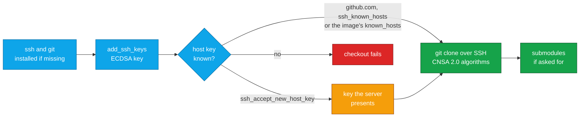

<div align="center">


# CoreCCI for CircleCI

### Check out code in FIPS mode, over SSH you can vouch for.

A drop-in replacement for CircleCI's `checkout` step: ECDSA keys that work with FIPS mode on,<br>
SSH algorithms from the NSA's CNSA 2.0 suite, pinned host keys, and shallow checkouts.<br>
No host key trusted on first use by default · No usage data collected by the orb

[](https://circleci.com/gh/juburr/corecci)
[](https://circleci.com/developer/orbs/orb/juburr/corecci)
[](LICENSE)
[](https://discuss.circleci.com/c/ecosystem/orbs)


**[Quick Start](#-quick-start)** · **[Features](#-why-corecci)** · **[Command](#-circleci-commands)** · **[Host Keys](#-host-keys)** · **[CNSA 2.0](#-fips-and-cnsa-20)** · **[Upgrading](#-upgrading)**

<sub>An unofficial, community-maintained CircleCI orb. [Contributions are welcome!](#-contributing)</sub>

</div>

<br>

## ✨ Why corecci?

<table>
<tr>
<td width="33%" valign="top">
🛡️ <b>Works with FIPS mode on</b><br><br>
CircleCI generates ED25519 deploy keys, which FIPS mode rejects, so its <code>checkout</code> fails in <code>ubi9</code> or Rocky Linux 9 images on FIPS hosts. <code>corecci/checkout</code> uses an ECDSA key you add to the project instead.
</td>
<td width="33%" valign="top">
🔐 <b>CNSA 2.0 SSH algorithms</b><br><br>
AES-256-GCM, ECDH over P-384 and SHA-384 fingerprints by default, the SSH algorithms <a href="https://datatracker.ietf.org/doc/html/rfc9212">RFC 9212</a> lists for the NSA's Commercial National Security Algorithm Suite.
</td>
<td width="33%" valign="top">
📌 <b>Pinned host keys</b><br><br>
GitHub's published host keys for github.com, your server's keys from <code>ssh_known_hosts</code>, or the image's own <code>known_hosts</code>. The server's key is never trusted on first use unless you ask for it.
</td>
</tr>
<tr>
<td width="33%" valign="top">
⚡ <b>Shallow checkouts</b><br><br>
<code>depth: shallow</code> fetches only the pipeline's commit. On one large repository, checkouts fell from 20 to 35 seconds to about 2. <code>depth: empty</code> fetches the history without checking out any files.
</td>
<td width="33%" valign="top">
🧩 <b>Submodules and Go modules</b><br><br>
Check out submodules recursively or not, shallow or not. <code>configure_git_ssh</code> sends <code>https://</code> URLs of the repository's host over SSH, so <code>go mod download</code> needs no token.
</td>
<td width="33%" valign="top">
📦 <b>Installs ssh and git</b><br><br>
Images without them, such as UBI, Rocky Linux and Debian, get them from <code>dnf</code>, <code>microdnf</code>, <code>yum</code>, <code>apt-get</code> or <code>apk</code> before the checkout.
</td>
</tr>
</table>

### 🧩 The Orb vs. CircleCI's `checkout`

| | CircleCI's `checkout` | `corecci/checkout` |
| --- | --- | --- |
| **FIPS mode** | Fails with the ED25519 deploy key CircleCI generates | Uses an ECDSA key from the project's additional SSH keys |
| **SSH algorithms** | ssh's defaults | AES-256-GCM, ECDH P-384 and SHA-384 fingerprints by default, all configurable |
| **Host keys** | Known keys for a few public hosts | GitHub's published keys, your own for other servers, and an error rather than trust on first use |
| **Depth** | The whole history | `full`, `shallow` (one commit) or `empty` (no files) |
| **Submodules** | Not checked out | Recursive or top-level, full or shallow |
| **Images without ssh or git** | Falls back to CircleCI's own git client | Installs them first |

## 🔄 How It Works



The command installs `ssh` and `git` if the image lacks them, adds the key whose fingerprint you give, and checks the server's host key before anything connects (see [Host Keys](#-host-keys)). It then checks out the pipeline's commit with the SSH settings in [FIPS and CNSA 2.0](#-fips-and-cnsa-20), and exports them as `GIT_SSH_COMMAND` for the job's later steps.

## 🚀 Quick Start

1. Generate an ECDSA key on P-384, which CNSA 2.0 calls for, with no passphrase (CircleCI can't use one):

   ```bash
   ssh-keygen -t ecdsa -b 384 -N "" -C circleci -f circleci_key
   ```

2. In the repository's settings on GitHub, under **Deploy keys**, add the public key, `circleci_key.pub`, which starts with `ecdsa-sha2-nistp384`.

   > [!TIP]
   > For many repositories, add the key to a GitHub machine user for CircleCI instead, and give that user access to the repositories.

3. In the project's settings in CircleCI, under **SSH Keys**, add the private key, `circleci_key`, under **Additional SSH Keys**, with the host name `github.com` (or your GitHub Enterprise Server's). Don't use **Add Deploy Key** there: it generates an ED25519 key, which FIPS mode rejects.

4. CircleCI shows the key's fingerprint. Pass it to `corecci/checkout` in place of `checkout`:

   ```yaml
   version: 2.1

   orbs:
     corecci: juburr/corecci@1.0.0

   jobs:
     ubi9_fips_job:
       docker:
         - image: registry.access.redhat.com/ubi9/ubi
       resource_class: small
       steps:
         - corecci/checkout:
             depth: shallow
             fingerprint: "SHA256:VxLl73fnnzz4g4hmlxIhnq9+pONpFQtLNl8j9U8qEzE"
             submodules: recursive-shallow

   workflows:
     use-my-orb:
       jobs:
         - ubi9_fips_job
   ```

On a GitHub Enterprise Server, also set [`ssh_known_hosts`](#-host-keys) to its host keys.

## 🧰 CircleCI Commands

### `corecci/checkout`

Checks out the pipeline's commit (`CIRCLE_SHA1`, or `CIRCLE_TAG` or `CIRCLE_BRANCH` without it) from `CIRCLE_REPOSITORY_URL` into the working directory, over SSH. An `https://` repository URL is cloned over SSH as `git@<host>:<path>`. Needs bash 4 or newer in the image.

| Parameter | Default | Description |
| --- | --- | --- |
| `fingerprint` | *(empty)* | Fingerprint (`SHA256:...` or MD5) of an ECDSA key in the project's additional SSH keys. Needed in FIPS mode. Empty uses the project's deploy key. |
| `depth` | `full` | `full` (the whole history), `shallow` (only the pipeline's commit) or `empty` (the whole history, no files checked out). |
| `submodules` | `none` | `none`, `recursive`, `recursive-shallow`, `top-level` or `top-level-shallow`. The shallow ones fetch only each submodule's commit. Not with `depth: empty`. |
| `ssh_known_hosts` | *(empty)* | `known_hosts` lines with the server's host keys. Empty uses GitHub's published keys for github.com, or the image's `known_hosts` for other hosts. See [Host Keys](#-host-keys). |
| `ssh_accept_new_host_key` | `false` | Trust the key the server presents, unchecked, when no key for it is known. See [Host Keys](#-host-keys). |
| `configure_git_ssh` | `true` | Configure git globally to fetch `https://` URLs of the repository's host over SSH, with the same key and settings. |
| `install_packages` | `true` | Install `ssh` and `git` with the image's package manager if either is missing. |
| `ssh_ciphers` | `aes256-gcm@openssh.com` | Comma-separated SSH ciphers. |
| `ssh_kex_algorithms` | `ecdh-sha2-nistp384` | Comma-separated SSH key exchange algorithms. |
| `ssh_host_key_algorithms` | `ecdsa-sha2-nistp384,ecdsa-sha2-nistp256,rsa-sha2-512` | Comma-separated SSH host key algorithms. |
| `ssh_fingerprint_hash` | `sha384` | Hash for the fingerprints ssh prints. One value, not a list. |

Environment variables are expanded in `ssh_known_hosts` and the `ssh_*` lists. `fingerprint` must be written out, since CircleCI's `add_ssh_keys` reads it as it is, and CircleCI checks the enums and booleans before any step runs, so they can't take a variable. The `ssh_*` lists take algorithm names only, since they become part of `GIT_SSH_COMMAND`, which a shell runs.

The checkout exports `GIT_SSH_COMMAND` through `BASH_ENV`, so later `git fetch`, `git push` or `go mod download` steps in the job use the same key, algorithms and host keys.

## 📌 Host Keys

Before it connects, the command makes sure `~/.ssh/known_hosts` holds the server's host key, and ssh then refuses any other (`StrictHostKeyChecking=yes`). The first of these that applies decides:

1. **`ssh_known_hosts`**: the lines you give become the only keys trusted for the host.
2. **github.com**: GitHub's [published host keys](https://docs.github.com/en/authentication/keeping-your-account-and-data-secure/githubs-ssh-key-fingerprints) become the only keys trusted for it.
3. **The image's `known_hosts`**: a key for the host already in `~/.ssh/known_hosts` or `/etc/ssh/ssh_known_hosts` is used as it is.
4. **`ssh_accept_new_host_key: true`**: the key the server presents now is trusted, with a warning.
5. Otherwise the checkout fails, before connecting.

ssh accepts a host key that any `known_hosts` line names, so in the first two cases the host's other keys are removed from `~/.ssh/known_hosts`, and `GIT_SSH_COMMAND` ignores the system-wide `/etc/ssh/ssh_known_hosts`, after copying its lines for other hosts into `~/.ssh/known_hosts`. An image that still trusts an old key, such as GitHub's RSA key from before 2023, can't undo the pin. That needs `ssh-keygen`, which ships with ssh.

For a GitHub Enterprise Server, get its keys from a source you trust, such as its administrator or `ssh-keyscan` from a machine on a trusted network checked against the fingerprints they publish. Store the lines in a context, and pass the variable:

```yaml
- corecci/checkout:
    fingerprint: "SHA256:..."
    ssh_known_hosts: ${GHES_KNOWN_HOSTS}
```

A server on a port other than 22 is named `[host]:port` in its `known_hosts` lines. If GitHub rotates its keys before this orb is updated, pass the new ones in `ssh_known_hosts`.

## 🔐 FIPS and CNSA 2.0

This orb aims at the SSH algorithms [RFC 9212](https://datatracker.ietf.org/doc/html/rfc9212) lists for CNSA 2.0, but the defaults are **not yet fully CNSA 2.0 compliant**: GitHub offers no `ecdsa-sha2-nistp384` host key, so `ecdsa-sha2-nistp256` is in the default host key algorithms. `rsa-sha2-512` is also there and compliant, and GitHub offers it.

| SSH setting | Default |
| --- | --- |
| Ciphers | `aes256-gcm@openssh.com` |
| KexAlgorithms | `ecdh-sha2-nistp384` |
| HostKeyAlgorithms | `ecdsa-sha2-nistp384,ecdsa-sha2-nistp256,rsa-sha2-512` (the exception) |
| FingerprintHash | `sha384` |

For a server with an `ecdsa-sha2-nistp384` host key, such as a GitHub Enterprise Server you configure, set `ssh_host_key_algorithms: ecdsa-sha2-nistp384,rsa-sha2-512`.

FIPS mode depends on the host. CircleCI's cloud hosts don't appear to run in it, so the problem shows on self-hosted CircleCI server and runners kept to NIST SP 800-171 or CMMC, where `ubi9` and Rocky Linux 9 images inherit FIPS mode from the host.

## 📦 Upgrading

Upgrading from v0.5.1 to v1.0.0? The parameters keep their names; two are new (`ssh_known_hosts` and `ssh_accept_new_host_key`). Behavior changes:

- **Host keys are checked.** Before, the command trusted whatever key the server presented first. Now github.com uses GitHub's published keys, and any other host needs `ssh_known_hosts`, a key in the image's `known_hosts`, or `ssh_accept_new_host_key: true`, which restores the old behavior. Without one of them, a checkout from a GitHub Enterprise Server fails with an error saying so.
- **`depth: empty` checks out into the working directory.** Before, it cloned into a subdirectory named after the repository.
- **`configure_git_ssh` takes effect before the checkout**, so submodules listed by `https://` URL on the repository's host come over SSH too.
- **`install_packages` picks the package manager it finds** (`apt-get`, `apk`, `dnf`, `microdnf` or `yum`) instead of the distribution's release file, which adds RHEL 10, Rocky Linux 10, UBI minimal and Debian images.
- **Values are checked before anything runs.** Booleans take `true` or `false`, the `ssh_*` lists take algorithm names only, and `fingerprint` takes a `SHA256:` or MD5 fingerprint.
- **Messages** start with `ERROR:` or `WARN:` and go to stderr.

## 🔒 Secure by Design

- **Authenticity**: The server's host key is checked against keys from a source you trust before anything connects, and never trusted on first use unless `ssh_accept_new_host_key` says so.
- **Least exposure**: With a `fingerprint`, ssh uses that key file only (`IdentitiesOnly`, no `ssh-agent`), and never forwards the agent or X11.
- **Injection-safe**: Parameter values reach `circleci env subst` on stdin, the `ssh_*` values are checked before they join `GIT_SSH_COMMAND`, and the export to `BASH_ENV` is quoted with `printf %q`.
- **Confidentiality**: All secrets and environment variables are handled in accordance with CircleCI's [security recommendations](https://circleci.com/docs/security-recommendations/) and [best practices](https://circleci.com/docs/orbs-best-practices/). The private key stays in the file `add_ssh_keys` writes.
- **Privacy**: No usage data of any kind is collected or shipped back to the orb developer.

## 💻 Supported Platforms

Linux images with bash 4 or newer, on any architecture:

| Image family | Package manager for `install_packages` | Tested in CI |
| --- | --- | --- |
| CircleCI `cimg` images | none needed | `cimg/base:current` |
| RHEL, UBI, Rocky Linux and other Enterprise Linux 8 to 10 | `dnf`, `microdnf` (UBI minimal) or `yum` | Rocky Linux 9 and 10, UBI 9 minimal, UBI 10 |
| Debian and Ubuntu | `apt-get` | Debian 12 |
| Alpine and Wolfi, with bash added | `apk` | — |

`install_packages` needs root in the image, as CircleCI's Docker executor runs it by default.

## 🤝 Contributing

This is an unofficial, community-maintained orb, and contributions are welcome! Bug reports, feature ideas and pull requests all help.

- **Found a bug or have an idea?** [Open an issue](https://github.com/juburr/corecci/issues).
- **Before opening a pull request**, run the checks CI runs. The tests run offline: `tests/checkout_test.sh` checks out local repositories with the real git and stand-ins for ssh, ssh-keygen and the CircleCI CLI, and `tests/install_deps_test.sh` runs the install with stand-in package managers. `circleci orb validate` checks the packed orb against the CircleCI API, so it needs network access. CI also checks out this repository with the orb on each image in [Supported Platforms](#-supported-platforms).

  ```bash
  yamllint .
  shellcheck src/scripts/*.sh tests/*.sh
  for t in tests/*_test.sh; do bash "$t" || break; done
  circleci orb pack src > orb.yml && circleci orb validate orb.yml
  ```

## 🎨 Logo

Need the logo for a slide deck, blog post, or internal developer portal? A PNG with a transparent background is in [`assets/logos`](assets/logos): [500](assets/logos/corecci_500px.png) px

## 📜 License

[MIT](LICENSE) © 2024-2025 Justin Burr

<br>

<div align="center">
  
  <br>
  <sub>Check out code you can vouch for. If this orb helps your team, a ⭐ helps others find it.</sub>
  <br>
  <sub><a href="#corecci-for-circleci">Back to top ↑</a></sub>
</div>
